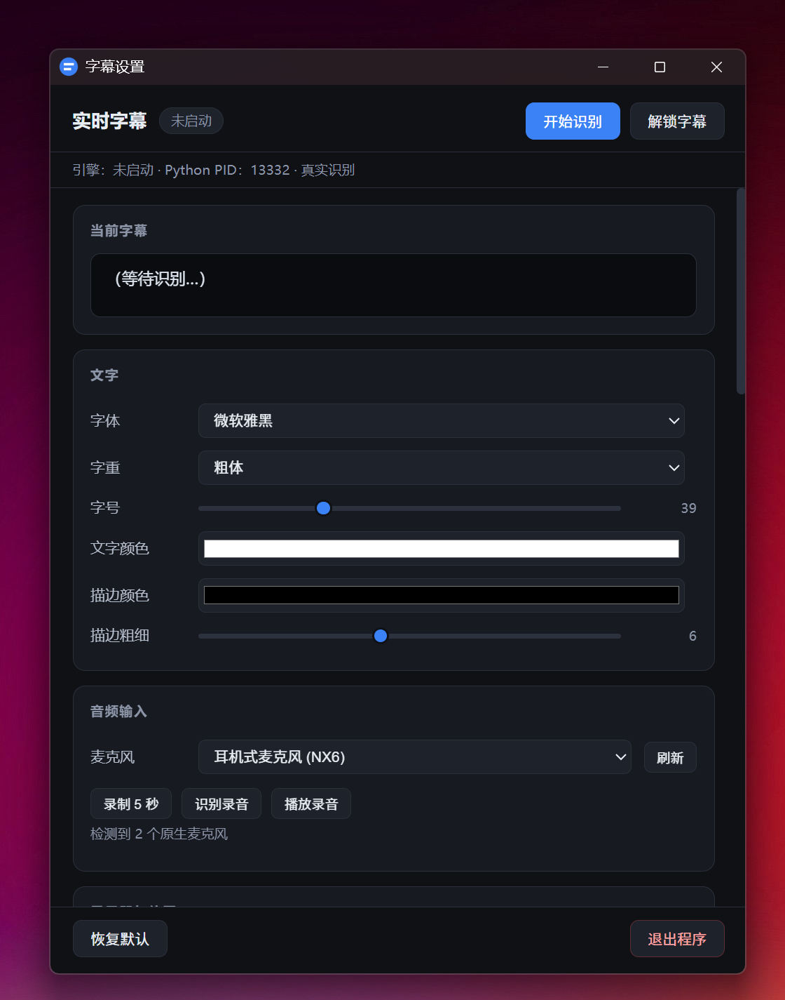

# livetool

## 简介

一个开源的直播工具，目前只实现了实时字幕功能，后续会实现其它有意思的功能。

## 实现原理

使用funasr、whisper模型实现语音识别、断句，然后用electron框架显示识别内容字幕到屏幕上。

## 视频介绍

- [https://www.bilibili.com/video/BV1aBJz6EEtE](https://www.bilibili.com/video/BV1aBJz6EEtE)

## 功能列表

- [x] 实时字幕

## 系统支持

- [x] Windows
- [ ] macOS
- [ ] Linux

## 界面截图

